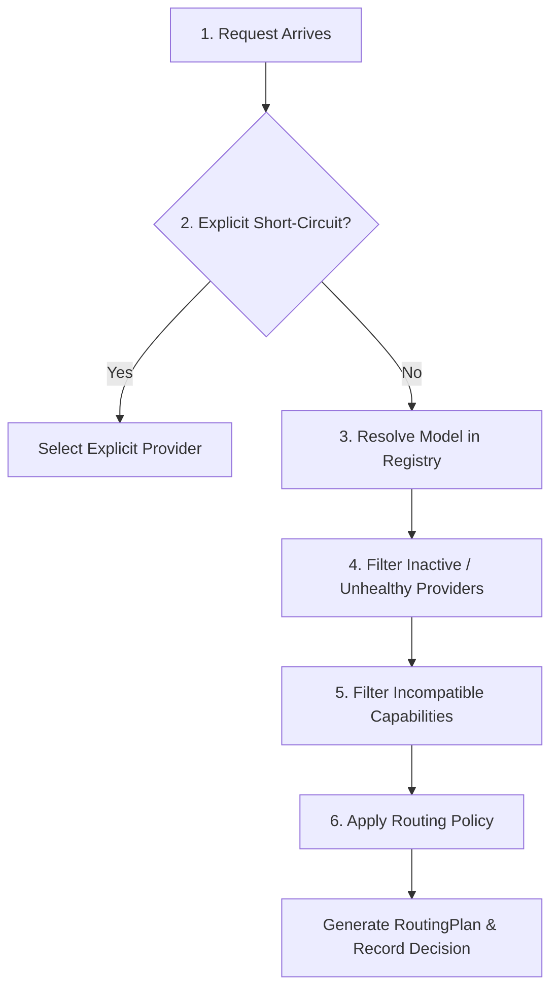

# Routing Engine & Policy Architecture

This document describes how the **AI Gateway** resolves model identifiers, evaluates candidate providers, applies selection policies, and manages automated fallbacks.

---

## 1. Model Addressing Modes

The gateway supports two complementary addressing modes: **Logical Aliases** and **Explicit Model IDs**.

```text
                     ┌───────────────────────────────┐
                     │ Incoming Request `model` field│
                     └───────────────┬───────────────┘
                                     │
                    Does it contain a slash '/'?
                                    / \
                                   /   \
                             Yes  /     \  No
                                 /       \
                                ▼         ▼
                 ┌────────────────────┐  ┌───────────────────────┐
                 │ Explicit Addressing│  │   Logical Aliases     │
                 │ "provider/model_id"│  │     "coding-fast"     │
                 └─────────┬──────────┘  └───────────┬───────────┘
                           │                         │
                  Direct routing to           Evaluates candidate
                  single provider             array in priority order
```

### A. Logical Aliases (Policy-Driven)
Logical aliases decouple your client applications from individual model IDs and providers. A client requests a capability or tier, and the gateway selects the best operational provider based on availability and priority:

```yaml
models:
  coding-fast:
    description: "Low-latency coding model preferring local GPU"
    candidates:
      - provider: llama
        model: qwen3.5-9b
        priority: 1
      - provider: ollama
        model: qwen2.5-coder:7b
        priority: 2
      - provider: openrouter
        model: qwen/qwen3.5-35b
        priority: 3
```

**Benefits**:
- Instant failover if local GPU daemon restarts or crashes.
- Seamless model upgrades in config without changing client code.
- Dynamic traffic routing.

### B. Explicit Addressing (Reproducibility & Direct Access)
When you require a specific model version on a specific provider (for benchmark reproducibility or precise testing), prefix the provider name followed by `/`:

```json
{
  "model": "openrouter/anthropic/claude-3.5-sonnet",
  "messages": [...]
}
```

The gateway parses this directly as:
- **Provider**: `openrouter`
- **Upstream Model**: `anthropic/claude-3.5-sonnet`
- **Priority**: 0 (High priority direct deployment)

---

## 2. The 6-Stage Routing Pipeline

When a request reaches the routing engine ([`src/routing/mod.rs`](file:///s:/Code/RustProjects/AI-Gateway/src/routing/mod.rs#L82-L185)), it passes through a 6-stage pipeline:



### Stage 1: Explicit Short-Circuit Check
If the request includes routing hints with a forced provider:
```json
{
  "routing": {
    "provider": "llama"
  }
}
```
The router isolates candidates belonging to that provider, bypassing other configured candidates.

### Stage 2: Resolution
The router queries [`ModelRegistry::resolve`](file:///s:/Code/RustProjects/AI-Gateway/src/registry/model_registry.rs#L32):
- Resolves alias to defined candidates.
- Or parses explicit `provider/model` string.

### Stage 3: Availability Filtering
Every candidate's provider status is checked against [`ProviderRegistry::is_available`](file:///s:/Code/RustProjects/AI-Gateway/src/registry/provider_registry.rs#L82):
- Must have `enabled: true` in configuration.
- Must not be flagged as `ProviderHealth::Unhealthy` by the background health check worker.
- Rejected candidates are tracked with reason `"provider_unavailable"`.

A second, independent check follows: if the provider has a configured `max_concurrent`, its current in-flight request count (tracked by `ProviderRegistry::record_request_start`/`record_request_end`) must be below that limit, or the candidate is rejected with reason `"provider_at_capacity"` — a distinct reason from `"provider_unavailable"` since it's transient load, not a config/health problem. This check also applies to explicit `provider/model` addressing (Stage 1/2's short-circuits): `max_concurrent` is a resource-protection constraint, not a routing preference, so — like the administrative `enabled` switch — it is not bypassable by explicit addressing (docs/REMEDIATION_PLAN.md Phase 5.3).

A third check, same shape: if the provider has a configured `circuit_breaker_threshold`, `ProviderRegistry::is_circuit_open` is consulted and a tripped circuit rejects the candidate with reason `"provider_circuit_open"` — also not bypassable by explicit addressing, for the same resource-protection rationale. The breaker is a simple three-state machine per provider (`ProviderRegistry::record_request_end` drives the transitions):
- **Closed** (default): normal operation. `circuit_breaker_threshold` *consecutive* attempt failures (any success resets the counter to zero) trip it to Open.
- **Open**: every candidate check rejects with `"provider_circuit_open"` until `circuit_breaker_cooldown_secs` has elapsed since it opened, at which point the *next* routing check (there's no background timer — a single-user gateway may sit idle between requests) transitions it to HalfOpen.
- **HalfOpen**: one (or more — there's no dedicated single-trial lock) request is let through as a recovery probe. A success closes the circuit; a failure re-opens it with a fresh cooldown.

Distinguish this from the per-attempt retry/fallback logic below: fallback reacts to a single request's outcome and moves to the next candidate *within that request*; the circuit breaker persists state *across requests*, so a provider that has been consistently failing is skipped pre-emptively on the very next request rather than being retried and only then falling back, every time. See `docs/CONFIGURATION_GUIDE.md` for the config fields and `tests/routing_tests.rs`'s `test_circuit_breaker_*` tests for the state machine's exact behavior.

A fourth check, same shape again: if the provider has a configured `rate_limit_per_sec`, `ProviderRegistry::is_rate_limited` is consulted and a candidate whose provider has already admitted `rate_limit_per_sec` attempts within the current 1-second window is rejected with reason `"provider_rate_limited"` — also not bypassable by explicit addressing. This is a different axis from `max_concurrent`: concurrency bounds how many attempts are *simultaneously in flight*, the rate limit bounds how many new attempts *arrive* per second, so a provider can be well under its concurrency ceiling and still be rate-limited if attempts burst too tightly (relevant for a local inference server that serializes requests internally regardless of how many the gateway has open). The window is fixed, not sliding — `ProviderRegistry::is_rate_limited`'s doc comment spells out the resulting boundary-burst tradeoff.

### Stage 4: Capability Matching
The request's requirements are dynamically checked against candidate capabilities:

1. **Vision Inspection**:
   - The router inspects all messages for `ContentPart::ImageUrl`.
   - If image parts are present, candidates with `vision: false` are excluded.
2. **Tool Support**:
   - If the request supplies `tools: [...]`, candidates lacking tool support are rejected.
3. **Structured Output & Reasoning**:
   - If the request supplies `response_format` or `reasoning.enabled: true`, candidates lacking the corresponding capability flag are rejected.
4. **Context Window**:
   - If `ModelCandidate.max_context_length` is configured for a candidate, the router estimates the request's token usage (prompt content length / 4, plus `max_completion_tokens`/`max_tokens` if set — a rough heuristic, not a real tokenizer, since no tokenizer dependency exists in this project) and rejects the candidate with reason `"context_length_exceeded"` if the estimate exceeds the limit. A candidate with no configured `max_context_length` is never rejected on this basis. Because the estimate is a heuristic, it should be read as "obviously oversized requests are filtered before a wasted round-trip," not as an exact admission-control guarantee — a request close to the real limit can still surface as a provider-side error instead of being filtered here.

### Stage 5: Policy Application
The surviving candidates are ordered according to the configured routing policy:

| Policy | Behavior |
|:---|:---|
| **`priority` / `ordered`** (Default) | Sorts candidates strictly by `priority` integer (ascending: 1 is higher priority than 2). |
| **`round_robin`** | Distributes requests evenly across equal-priority candidates using a rolling atomic counter. |
| **`lowest_latency` / `fastest`** | Selects the candidate whose provider has the lowest average *inference* latency (a simple cumulative mean of completed attempt durations, reset only on restart — not an exponential moving average, and tracked separately from background health-check latency; see [`ProviderRegistry::record_latency`](file:///s:/Code/RustProjects/AI-Gateway/src/registry/provider_registry.rs)). `fastest` is the same `RoutingPolicy` enum's alternate name for identical behavior. |
| **`local_first`** | Prefers a candidate whose provider's `base_url` resolves to loopback or a private/link-local address (real host data, not a guess by `provider.type` — see [`ProviderConfig::is_local`](file:///s:/Code/RustProjects/AI-Gateway/src/types/provider.rs)), falling back to `priority` among ties. |
| **`cheapest`** | Ranks by estimated USD cost from `config.pricing` (`"provider/model"` → per-1k-token rates), using a chars/4 prompt-token estimate and `max_completion_tokens`/`max_tokens` (or a fixed 256-token assumption if unset) for the completion side — the same estimate framing `/v1/analytics/costs` already uses ("estimated," never "billed"). A candidate with **no** pricing entry sorts *last*, never first — unpriced is not the same as free. |
| **`highest_quality`** | Ranks by the candidate's operator-declared `ModelCandidate.quality_tier` (lower value = higher quality, same convention as `priority`). There is no benchmark/eval data anywhere in this gateway to derive a quality score automatically, so this is explicit config input, never gateway-inferred — an undeclared `quality_tier` sorts last. |
| **`balanced`** | Combines `cheapest`, `lowest_latency`, and `highest_quality`'s three signals via Borda-style rank summing: each candidate is ranked independently on each dimension (0 = best on that dimension; ties share a rank), and the three ranks are summed — lowest total wins. Avoids an arbitrary weighted-average formula while still using all three real signals. A candidate missing data on a dimension gets that dimension's worst rank, not an assumed-average one. |

Every `RoutingPolicy` enum variant has real dispatch logic as of this table — `routing.default_policy` and a per-request `routing.policy` override are both validated against the same recognized-name list, and only a genuinely unrecognized name (a typo) fails with a clear error rather than silently running ordered routing instead.

### Stage 6: Decision Telemetry
The router constructs a [`RoutingDecision`](file:///s:/Code/RustProjects/AI-Gateway/src/routing/mod.rs#L40-L69) object:
- `requested_model`: Original string sent by client.
- `resolution_type`: `"alias"` or `"explicit"`.
- `candidates_considered`: Count of all possible candidates.
- `candidates_rejected`: Count of discarded candidates.
- `rejection_reasons`: Structured list of `(provider, model, reason)`.
- `selected_provider`: Target provider for first attempt.
- `selected_model`: Upstream model identifier.
- `policy_applied`: Name of policy used.

This is dispatched asynchronously to the telemetry pipeline so that **every routing decision's rationale is permanently auditable**.

---

## 3. Fallback & Retry Mechanics

When communicating with LLM providers, network timeouts, rate limits (429), and upstream server errors (500/502/503) are common. The gateway implements multi-level fault tolerance.

### Configurable Fallback Triggers

Configured via `routing.fallback_on` in [`config/gateway.yaml`](file:///s:/Code/RustProjects/AI-Gateway/config/gateway.yaml#L116-L120):

```yaml
routing:
  max_retries_per_provider: 2
  attempt_timeout_secs: 120
  fallback_on:
    - timeout
    - rate_limit
    - unavailable
    - server_error
    - content_filter
```

| Trigger | Matching HTTP Status Codes | Matching Error Strings | Action |
|:---|:---|:---|:---|
| **`timeout`** | `504 Gateway Timeout` | `"timeout"`, `"connect_timeout"` | Fallback to next candidate |
| **`rate_limit`** | `429 Too Many Requests` | `"rate_limit"` | Fallback to next candidate |
| **`unavailable`** | `502 Bad Gateway`, `503 Service Unavailable` | `"connection_refused"`, `"dns_error"`, `"unavailable"` | Fallback to next candidate |
| **`server_error`** | `>= 500 Internal Server Error` | `"server_error"` | Fallback to next candidate |
| **`content_filter`** | `451 Unavailable For Legal Reasons` | `"content_filter"` | Fallback to next candidate |

### Intra-Provider Retry vs Inter-Provider Fallback
1. **Intra-Provider Retry**:
   If an error is retryable (such as transient rate limits or 503) and attempts on this provider are below `max_retries_per_provider`, the gateway performs exponential backoff with ±20% jitter (capped at 5 s):
   $$\text{delay} = 200\text{ms} \times 2^{\text{attempt}}$$
   and retries the **same** provider. If the provider sent `Retry-After` (seconds or HTTP-date) or `retry-after-ms`, the wait is at least that long. A `Retry-After` longer than `routing.max_retry_after_secs` (default 10) is not waited out: the gateway stops retrying that provider and falls through to the next candidate at once. In both cases the provider is put in a cooldown for the time it asked for (max 5 minutes), during which routing skips it with rejection reason `provider_rate_limited` — so a throttled free tier is not retried by every following request. The error `unsupported_endpoint` (e.g. `/v1/completions` on Gemini) always falls through, regardless of `fallback_on`.
2. **Inter-Provider Fallback**:
   If the error matches `fallback_on` and provider retries are exhausted or non-retryable, the gateway immediately switches to the **next candidate in the plan**.

### Candidate Exhaustion
If all candidates fail, the gateway logs `RequestCompleted { success: false }` to telemetry and returns a clean, OpenAI-compatible JSON error:
```json
{
  "error": {
    "message": "All providers failed: upstream server error: 503",
    "type": "all_providers_failed",
    "code": "all_providers_failed"
  }
}
```
HTTP status: `502 Bad Gateway`.

## Response Caching

An opt-in (`caching.enabled`, default `false`), in-memory, exact-match cache sitting *before* routing entirely — a cache hit skips model resolution, candidate filtering, policy application, and provider dispatch in one step (`src/cache/mod.rs`, `ResponseCache`).

**Scoped to non-streaming chat completions only.** A request with `stream: true` is never checked against the cache and never populates it, and a cache hit is never served as a synthetic stream. This is a deliberate v1 scope decision, not an oversight: replaying a cached completion as SSE would need the same "synthetic event reconstruction" machinery `InstrumentedStream` already uses for a non-streaming provider response (see its `synthetic` field), and building that out is left for a later pass if the non-streaming case proves valuable enough to justify it.

**Cache key**: the entire serialized request minus `request_id`, `received_at`, and `stream` (normalized to `false`) — see `cache_key_for`'s doc comment for why this is a "serialize everything, then subtract the known non-semantic fields" strategy rather than a hand-maintained allowlist of fields to include (an allowlist silently goes stale every time a new request field is added, the exact class of bug several of this project's audits have flagged elsewhere). Two requests differing only in `stream` share a cache entry; anything else differing (model, messages, temperature, tools, routing hints, `metadata`, ...) is a different key.

**What this means in practice**: caching is exact-match, not semantic — a byte-for-byte-different-but-meaning-the-same-thing request (different whitespace, a rephrased question) is a cache miss. There is no embedding-similarity layer; adding one is exactly the "semantic caching" v2 item this plan's Phase 5 originally deferred, and remains deferred here.

**TTL and eviction**: `caching.ttl_secs` (default 300) bounds staleness; `caching.max_entries` (default 1000) bounds memory, evicting the oldest-*inserted* entry (not oldest-*accessed* — a full LRU wasn't judged worth the added complexity for a personal single-process gateway) once exceeded. The cache lives only in process memory — never persisted, never shared across instances, lost on restart. This is a performance optimization, not data of record; nothing about telemetry/analytics correctness depends on it.

**Telemetry on a hit**: still emits `RequestReceived` (so every incoming request is recorded) and `RequestCompleted` with `success: true`, `total_attempts: 0`, and `serving_provider`/`resolved_model` copied from whichever real dispatch originally populated the cache entry — an honest record of "served from cache," not a fabricated "no provider involved." `total_attempts: 0` combined with `success: true` is otherwise unreachable (the only other zero-attempts case, a routing failure with no viable candidates, is always `success: false`), so this combination doubles as an analyzable cache-hit marker without a schema change. The HTTP response itself also carries an `x-cache: HIT` header.
