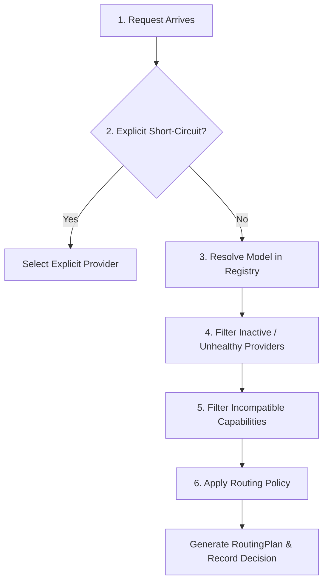

# Routing Engine & Policy Architecture

This document describes how the **AI Gateway** resolves model identifiers, evaluates candidate providers, applies selection policies, and manages automated fallbacks.

---

## 1. Model Addressing Modes

The gateway supports two complementary addressing modes: **Logical Aliases** and **Explicit Model IDs**.

```text
                     ┌───────────────────────────────┐
                     │ Incoming Request `model` field│
                     └───────────────┬───────────────┘
                                     │
                    Does it contain a slash '/'?
                                    / \
                                   /   \
                             Yes  /     \  No
                                 /       \
                                ▼         ▼
                 ┌────────────────────┐  ┌───────────────────────┐
                 │ Explicit Addressing│  │   Logical Aliases     │
                 │ "provider/model_id"│  │     "coding-fast"     │
                 └─────────┬──────────┘  └───────────┬───────────┘
                           │                         │
                  Direct routing to           Evaluates candidate
                  single provider             array in priority order
```

### A. Logical Aliases (Policy-Driven)
Logical aliases decouple your client applications from individual model IDs and providers. A client requests a capability or tier, and the gateway selects the best operational provider based on availability and priority:

```yaml
models:
  coding-fast:
    description: "Low-latency coding model preferring local GPU"
    candidates:
      - provider: llama
        model: qwen3.5-9b
        priority: 1
      - provider: ollama
        model: qwen2.5-coder:7b
        priority: 2
      - provider: openrouter
        model: qwen/qwen3.5-35b
        priority: 3
```

**Benefits**:
- Instant failover if local GPU daemon restarts or crashes.
- Seamless model upgrades in config without changing client code.
- Dynamic traffic routing.

### B. Explicit Addressing (Reproducibility & Direct Access)
When you require a specific model version on a specific provider (for benchmark reproducibility or precise testing), prefix the provider name followed by `/`:

```json
{
  "model": "openrouter/anthropic/claude-3.5-sonnet",
  "messages": [...]
}
```

The gateway parses this directly as:
- **Provider**: `openrouter`
- **Upstream Model**: `anthropic/claude-3.5-sonnet`
- **Priority**: 0 (High priority direct deployment)

---

## 2. The 6-Stage Routing Pipeline

When a request reaches the routing engine ([`src/routing/mod.rs`](file:///s:/Code/RustProjects/AI-Gateway/src/routing/mod.rs#L82-L185)), it passes through a 6-stage pipeline:



### Stage 1: Explicit Short-Circuit Check
If the request includes routing hints with a forced provider:
```json
{
  "routing": {
    "provider": "llama"
  }
}
```
The router isolates candidates belonging to that provider, bypassing other configured candidates.

### Stage 2: Resolution
The router queries [`ModelRegistry::resolve`](file:///s:/Code/RustProjects/AI-Gateway/src/registry/model_registry.rs#L32):
- Resolves alias to defined candidates.
- Or parses explicit `provider/model` string.

### Stage 3: Availability Filtering
Every candidate's provider status is checked against [`ProviderRegistry::is_available`](file:///s:/Code/RustProjects/AI-Gateway/src/registry/provider_registry.rs#L82):
- Must have `enabled: true` in configuration.
- Must not be flagged as `ProviderHealth::Unhealthy` by the background health check worker.
- Rejected candidates are tracked with reason: `"Provider 'X' is unavailable or unhealthy"`.

### Stage 4: Capability Matching
The request's requirements are dynamically checked against candidate capabilities:

1. **Vision Inspection**:
   - The router inspects all messages for `ContentPart::ImageUrl`.
   - If image parts are present, candidates with `vision: false` are excluded.
2. **Tool Support**:
   - If the request supplies `tools: [...]`, candidates lacking tool support are rejected.
3. **Context Window Limits**:
   - If the candidate defines `max_context_length` and estimated token count exceeds the limit, the candidate is disqualified.

### Stage 5: Policy Application
The surviving candidates are ordered according to the configured routing policy:

| Policy | Behavior |
|:---|:---|
| **`priority` / `ordered`** (Default) | Sorts candidates strictly by `priority` integer (ascending: 1 is higher priority than 2). |
| **`round_robin`** | Distributes requests evenly across equal-priority candidates using a rolling atomic counter. |
| **`lowest_latency`** | Selects the candidate whose provider has the lowest exponential moving average latency. |

### Stage 6: Decision Telemetry
The router constructs a [`RoutingDecision`](file:///s:/Code/RustProjects/AI-Gateway/src/routing/mod.rs#L40-L69) object:
- `requested_model`: Original string sent by client.
- `resolution_type`: `"alias"` or `"explicit"`.
- `candidates_considered`: Count of all possible candidates.
- `candidates_rejected`: Count of discarded candidates.
- `rejection_reasons`: Structured list of `(provider, model, reason)`.
- `selected_provider`: Target provider for first attempt.
- `selected_model`: Upstream model identifier.
- `policy_applied`: Name of policy used.

This is dispatched asynchronously to the telemetry pipeline so that **every routing decision's rationale is permanently auditable**.

---

## 3. Fallback & Retry Mechanics

When communicating with LLM providers, network timeouts, rate limits (429), and upstream server errors (500/502/503) are common. The gateway implements multi-level fault tolerance.

### Configurable Fallback Triggers

Configured via `routing.fallback_on` in [`config/gateway.yaml`](file:///s:/Code/RustProjects/AI-Gateway/config/gateway.yaml#L116-L120):

```yaml
routing:
  max_retries_per_provider: 2
  attempt_timeout_secs: 120
  fallback_on:
    - timeout
    - rate_limit
    - unavailable
    - server_error
    - content_filter
```

| Trigger | Matching HTTP Status Codes | Matching Error Strings | Action |
|:---|:---|:---|:---|
| **`timeout`** | `504 Gateway Timeout` | `"timeout"`, `"connect_timeout"` | Fallback to next candidate |
| **`rate_limit`** | `429 Too Many Requests` | `"rate_limit"` | Fallback to next candidate |
| **`unavailable`** | `502 Bad Gateway`, `503 Service Unavailable` | `"connection_refused"`, `"dns_error"`, `"unavailable"` | Fallback to next candidate |
| **`server_error`** | `>= 500 Internal Server Error` | `"server_error"` | Fallback to next candidate |
| **`content_filter`** | `451 Unavailable For Legal Reasons` | `"content_filter"` | Fallback to next candidate |

### Intra-Provider Retry vs Inter-Provider Fallback
1. **Intra-Provider Retry**:
   If an error is retryable (such as transient rate limits or 503) and attempts on this provider are below `max_retries_per_provider`, the gateway performs exponential backoff:
   $$\text{delay} = 200\text{ms} \times 2^{\text{attempt}}$$
   and retries the **same** provider.
2. **Inter-Provider Fallback**:
   If the error matches `fallback_on` and provider retries are exhausted or non-retryable, the gateway immediately switches to the **next candidate in the plan**.

### Candidate Exhaustion
If all candidates fail, the gateway logs `RequestCompleted { success: false }` to telemetry and returns a clean, OpenAI-compatible JSON error:
```json
{
  "error": {
    "message": "All providers failed: upstream server error: 503",
    "type": "all_providers_failed",
    "code": "all_providers_failed"
  }
}
```
HTTP status: `502 Bad Gateway`.
