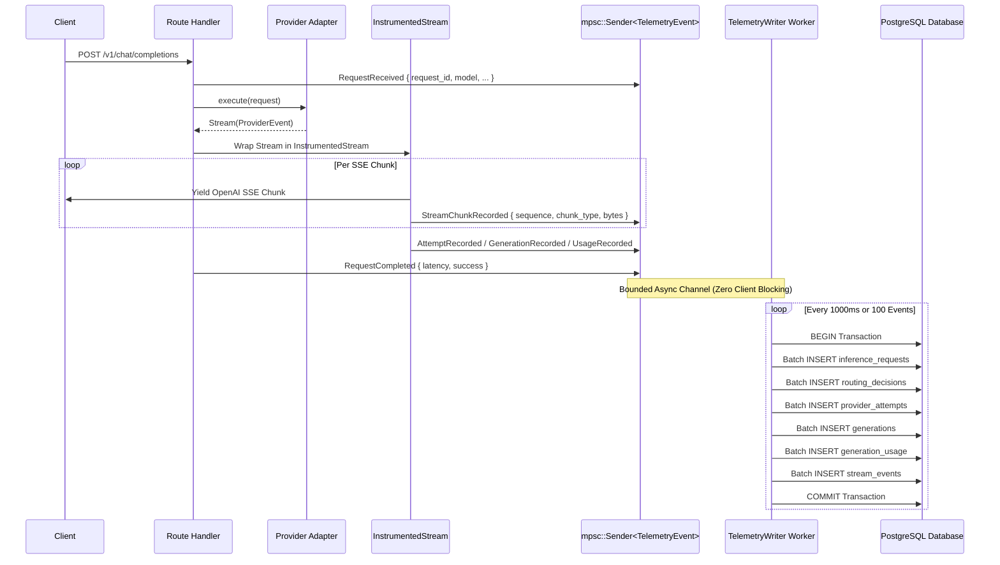
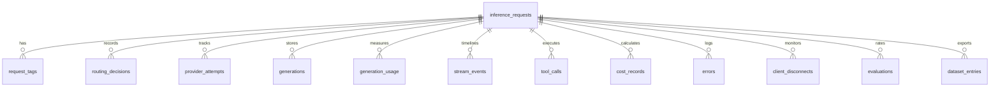

# Telemetry Architecture & Database Schema

This document details the first-class telemetry pipeline and relational PostgreSQL storage model in the **AI Gateway**.

---

## 1. Design Philosophy

> **"Store observations; calculate summaries. Never permanently reduce raw data into aggregates."**

Most traditional gateways aggregate latency into a single average number (e.g., `avg_latency: 42ms`) and discard raw token events. This destroys the information needed to detect GPU thermal throttling, inter-chunk jitter, prompt-processing bottlenecks, or provider degradation.

The AI Gateway stores granular observations:
- Every chunk's receipt timestamp and byte size (`stream_events`).
- Every routing candidate considered and the exact reason for rejection (`routing_decisions`).
- Every candidate attempt in a fallback chain (`provider_attempts`).
- Full generated text and reasoning thoughts for future dataset curation and fine-tuning (`generations`).
- Exact token counts partitioned into prompt, completion, cached, and reasoning tokens (`generation_usage`).

---

## 2. Telemetry Pipeline Architecture



---

## 3. Relational Database Schema (12 Tables)

The gateway initializes and runs automatic migrations at startup via `sqlx::migrate!("./migrations")`.



### Table Breakdown

| Table | Primary Purpose | Key Fields |
|:---|:---|:---|
| [`inference_requests`](file:///s:/Code/RustProjects/AI-Gateway/migrations/001_initial_schema.sql#L19) | Top-level request entity | `request_id` (UUIDv7), `received_at`, `requested_model`, `resolved_model`, `serving_provider`, `success`, `total_latency_us`, `canonical_messages` (JSONB) |
| [`request_tags`](file:///s:/Code/RustProjects/AI-Gateway/migrations/001_initial_schema.sql#L63) | User-defined classification | `request_id`, `tag` (e.g. `eval`, `benchmark`, `test`, `prod`) |
| [`routing_decisions`](file:///s:/Code/RustProjects/AI-Gateway/migrations/001_initial_schema.sql#L77) | Full routing audit trail | `request_id`, `requested_model`, `candidates_considered`, `candidates_rejected`, `rejection_reasons` (JSONB), `policy_applied` |
| [`provider_attempts`](file:///s:/Code/RustProjects/AI-Gateway/migrations/001_initial_schema.sql#L106) | Fallback chain attempts | `request_id`, `attempt_number`, `provider`, `model`, `status`, `duration_us`, `error_code`, `error_message` |
| [`generations`](file:///s:/Code/RustProjects/AI-Gateway/migrations/001_initial_schema.sql#L142) | Output text & reasoning | `request_id`, `content`, `reasoning_content`, `reasoning_visibility`, `tool_calls` (JSONB), `raw_response` (JSONB) |
| [`generation_usage`](file:///s:/Code/RustProjects/AI-Gateway/migrations/001_initial_schema.sql#L173) | Token usage breakdown | `request_id`, `prompt_tokens`, `completion_tokens`, `total_tokens`, `cached_tokens`, `reasoning_tokens` |
| [`stream_events`](file:///s:/Code/RustProjects/AI-Gateway/migrations/001_initial_schema.sql#L204) | Chunk-level timeline | `request_id`, `sequence`, `chunk_type`, `byte_count`, `timestamp` |
| [`tool_calls`](file:///s:/Code/RustProjects/AI-Gateway/migrations/001_initial_schema.sql#L222) | Function calling audit | `request_id`, `tool_name`, `tool_call_id`, `arguments` (JSONB) |
| [`cost_records`](file:///s:/Code/RustProjects/AI-Gateway/migrations/001_initial_schema.sql#L236) | Precise cost accounting | `request_id`, `prompt_cost_usd`, `completion_cost_usd`, `total_cost_usd` |
| [`errors`](file:///s:/Code/RustProjects/AI-Gateway/migrations/001_initial_schema.sql#L254) | Structured failure logs | `request_id`, `error_type`, `error_code`, `message`, `http_status` |
| [`client_disconnects`](file:///s:/Code/RustProjects/AI-Gateway/migrations/001_initial_schema.sql#L273) | Client abort tracking | `request_id`, `interrupted_at`, `bytes_delivered` |
| [`evaluations`](file:///s:/Code/RustProjects/AI-Gateway/migrations/001_initial_schema.sql#L288) | Quality scoring / human feedback | `request_id`, `metric`, `score`, `feedback` |

---

## 4. Streaming Performance Metrics

The gateway derives granular metrics from the `stream_events` and `provider_attempts` records:

1. **Time to First Token (TTFT)**:
   $$\text{TTFT} = \text{timestamp}(\text{chunk}_0) - \text{received\_at}$$
2. **Inter-Chunk Latency**:
   $$\Delta t_i = \text{timestamp}(\text{chunk}_i) - \text{timestamp}(\text{chunk}_{i-1})$$
   Enables detecting prompt evaluation vs token generation pauses.
3. **Generation Throughput (Tokens / Sec)**:
   $$\text{TPS} = \frac{\text{completion\_tokens}}{\text{stream\_duration\_seconds}}$$
4. **Gateway Overhead vs Provider Overhead**:
   $$\text{Gateway Overhead} = \text{total\_latency} - \sum \text{provider\_attempt\_durations}$$

---

## 5. Useful Analytical Queries

### A. Average TTFT and TPS by Provider and Model
```sql
SELECT 
    p.provider,
    p.model,
    COUNT(*) AS total_requests,
    ROUND(AVG(p.duration_us) / 1000.0, 2) AS avg_duration_ms,
    ROUND(AVG(u.completion_tokens * 1000000.0 / NULLIF(p.duration_us, 0)), 2) AS avg_tokens_per_sec
FROM provider_attempts p
JOIN generation_usage u ON p.request_id = u.request_id AND p.attempt_number = u.attempt_number
WHERE p.status = 'success'
GROUP BY p.provider, p.model
ORDER BY avg_tokens_per_sec DESC;
```

### B. Fallback Frequency & Root Cause Analysis
```sql
SELECT 
    r.selected_provider,
    p.provider AS failed_provider,
    p.error_code,
    COUNT(*) AS failure_count
FROM routing_decisions r
JOIN provider_attempts p ON r.request_id = p.request_id
WHERE p.status != 'success'
GROUP BY r.selected_provider, p.provider, p.error_code
ORDER BY failure_count DESC;
```

### C. Extract Supervised Fine-Tuning (SFT) Dataset
```sql
SELECT 
    r.canonical_messages AS messages,
    g.content AS assistant_response,
    g.reasoning_content AS reasoning
FROM inference_requests r
JOIN generations g ON r.request_id = g.request_id
WHERE r.success = TRUE 
  AND g.content IS NOT NULL
  AND LENGTH(g.content) > 50
ORDER BY r.created_at DESC;
```
