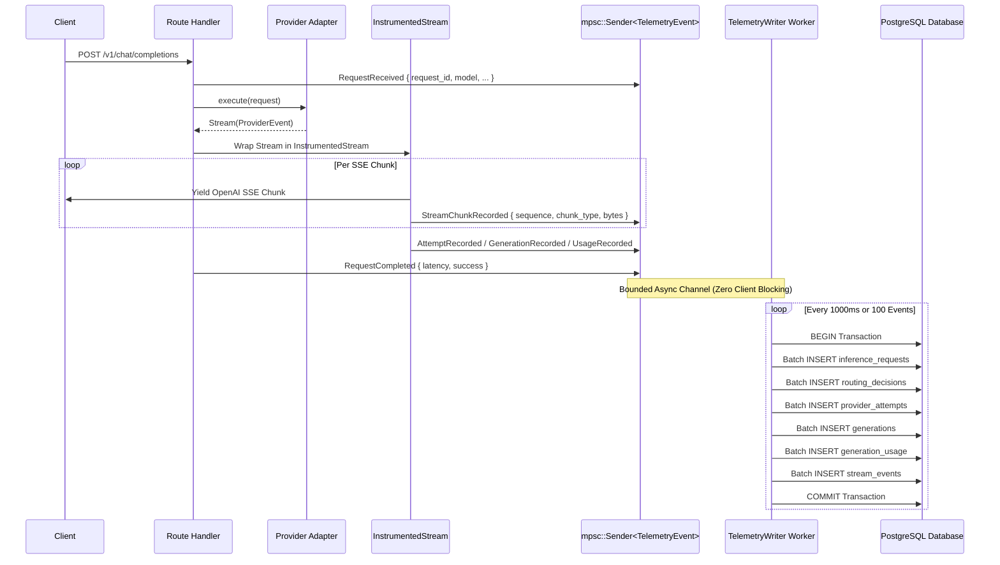
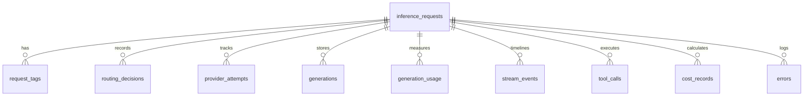

# Telemetry Architecture & Database Schema

This document details the first-class telemetry pipeline and relational PostgreSQL storage model in the **AI Gateway**.

---

## 1. Design Philosophy

> **"Store observations; calculate summaries. Never permanently reduce raw data into aggregates."**

Most traditional gateways aggregate latency into a single average number (e.g., `avg_latency: 42ms`) and discard raw token events. This destroys the information needed to detect GPU thermal throttling, inter-chunk jitter, prompt-processing bottlenecks, or provider degradation.

The AI Gateway stores granular observations:
- Every chunk's receipt timestamp and byte size (`stream_events`).
- Every routing candidate considered and the exact reason for rejection (`routing_decisions`).
- Every candidate attempt in a fallback chain (`provider_attempts`).
- Full generated text and reasoning thoughts for future dataset curation and fine-tuning (`generations`).
- Exact token counts partitioned into prompt, completion, cached, and reasoning tokens (`generation_usage`).

---

## 2. Telemetry Pipeline Architecture



---

## 3. Relational Database Schema (12 Tables)

The gateway initializes and runs automatic migrations at startup via `sqlx::migrate!("./migrations")`.



### Table Breakdown

| Table | Primary Purpose | Key Fields |
|:---|:---|:---|
| [`inference_requests`](file:///s:/Code/RustProjects/AI-Gateway/migrations/001_initial_schema.sql#L19) | Top-level request entity | `request_id` (UUIDv7, gateway-generated primary key), `client_correlation_id` (opaque client-supplied ID, e.g. `x-request-id` — never used as a join key), `received_at`, `requested_model`, `resolved_model`, `serving_provider`, `success`, `total_latency_us`, `canonical_messages` (JSONB) |
| [`request_tags`](file:///s:/Code/RustProjects/AI-Gateway/migrations/001_initial_schema.sql#L63) | User-defined classification | `request_id`, `tag` (e.g. `eval`, `benchmark`, `test`, `prod`) |
| [`routing_decisions`](file:///s:/Code/RustProjects/AI-Gateway/migrations/001_initial_schema.sql#L77) | Full routing audit trail | `request_id`, `requested_model`, `candidates_considered`, `candidates_rejected`, `rejection_reasons` (JSONB), `policy_applied` |
| [`provider_attempts`](file:///s:/Code/RustProjects/AI-Gateway/migrations/001_initial_schema.sql#L106) | Fallback chain attempts | `request_id`, `attempt_number`, `provider`, `model`, `status`, `timestamp` (started_at), `finished_at` (migration `005`), `duration_us`, `error_code`, `error_message`, `first_byte_at`, `first_token_at`, `synthetic_timing` (migration `004`) |
| [`generations`](file:///s:/Code/RustProjects/AI-Gateway/migrations/001_initial_schema.sql#L142) | Output text & reasoning, one row per choice | `id` (stable per-generation ID), `request_id`, `attempt_number`, `choice_index` (migration `006`, `0` for the common single-choice case), `status` (`'complete'`/`'partial'`, migration `006`), `content`, `reasoning_content`, `reasoning_visibility`, `tool_calls` (JSONB), `raw_response` (JSONB, only ever populated on `choice_index = 0`) |
| [`generation_usage`](file:///s:/Code/RustProjects/AI-Gateway/migrations/001_initial_schema.sql#L173) | Token usage breakdown, one row per raw observation | `id`, `request_id`, `attempt_number`, `prompt_tokens`, `completion_tokens`, `total_tokens`, `cached_tokens`, `reasoning_tokens`, `source` (migration `007`: `'stream_final'`/`'non_streaming'`), `kind` (migration `007`: always `'cumulative'` today — see below) |
| [`stream_events`](file:///s:/Code/RustProjects/AI-Gateway/migrations/001_initial_schema.sql#L204) | Chunk-level timeline | `request_id`, `sequence`, `chunk_type`, `byte_count`, `timestamp`, `synthetic` (migration `004`) |
| [`tool_calls`](file:///s:/Code/RustProjects/AI-Gateway/migrations/001_initial_schema.sql#L222) | Function calling audit | `request_id`, `function_name`, `tool_call_id`, `arguments` (JSON string) |
| [`errors`](file:///s:/Code/RustProjects/AI-Gateway/migrations/001_initial_schema.sql#L242) | Structured failure logs | `request_id`, `error_code`, `error_message`, `status_code`, `provider`, `retryable` |
| [`cost_records`](file:///s:/Code/RustProjects/AI-Gateway/migrations/001_initial_schema.sql#L263) | Estimated cost, computed from `config.pricing` (keyed by `"provider/model"`) against `generation_usage` when a price is configured for that deployment — no entry means no price was configured, not a zero cost | `request_id`, `estimated_cost`, `currency`, `provider`, `model`, `input_cost`, `output_cost` |
| [`model_snapshots`](file:///s:/Code/RustProjects/AI-Gateway/migrations/001_initial_schema.sql#L287) | Point-in-time model metadata, written once per model alias at gateway startup | `model_name`, `providers` (JSONB), `capabilities` (JSONB), `snapshot_at` |
| [`provider_snapshots`](file:///s:/Code/RustProjects/AI-Gateway/migrations/001_initial_schema.sql#L302) | Point-in-time provider health/counters, written on every background health-check tick (every 30s) | `provider_name`, `provider_type`, `health`, `total_requests`, `total_errors`, `avg_latency_ms`, `snapshot_at` |

### Usage observation semantics

`generation_usage` stores every `UsageRecorded` telemetry event as its own row rather than upserting one row per attempt — this preserves the raw observation history, but means more than one row can exist for the same `(request_id, attempt_number)`. Two facts govern how to read that correctly (docs/frontend/API_GAPS.md item 2):

1. **Every provider this gateway currently supports (OpenAI, OpenRouter, llama.cpp/llama-server, vLLM, Ollama, Gemini's OpenAI-compat layer) reports usage once per attempt, as a cumulative total for the whole response** — never as an incrementally increasing per-chunk delta. This is the documented, standardized convention (OpenAI's `stream_options.include_usage` delivers a single usage object in the final SSE chunk; the same shape appears once in a non-streaming response body). `generation_usage.kind` records this as `'cumulative'` on every row today; the column exists so a future provider that violates this convention could be represented without another schema change, not because deltas are expected in practice.
2. **More than one row for the same attempt is therefore an anomaly, not a designed sequence to reduce** — a redelivered telemetry event (identical values) or a genuinely conflicting double-report (different values), not a stream of partial counts to sum. Aggregate queries (`/v1/analytics/providers/comparison`, `/v1/analytics/summary`) pick one canonical row per attempt via `SELECT DISTINCT ON (request_id, attempt_number) ... ORDER BY id DESC` (most recently inserted wins) before computing any average, so an attempt is never counted or weighted more than once regardless of how many usage rows it has. `GET /v1/analytics/requests/{id}`'s `usage_canonical` array goes further and reports *why* a value was chosen: `quality: "single_observation"` (the normal case), `"duplicate_observations"` (more than one identical row), or `"conflicting_observations"` (more than one row with different values — flagged explicitly rather than silently resolved).

---

## 4. Streaming Performance Metrics

The gateway derives granular metrics from the `stream_events` and `provider_attempts` records:

**Always filter out fabricated timing first**: every query in this section should add `WHERE p.synthetic_timing = false` (for `provider_attempts`-only queries) or `WHERE s.synthetic = false` (for `stream_events`-level queries). A non-streaming request (`stream: false`, or a provider that only supports non-streaming) still produces `ContentDelta`/`FirstByte`/`FirstGenerationChunk` events internally — the full response arrives in one HTTP round-trip and gets replayed as a one-shot event sequence for a uniform code path — but every one of those events lands within microseconds of each other. Averaging that in with genuine per-chunk streaming timing would silently understate real TTFT/TPS/inter-chunk latency. See docs/REMEDIATION_PLAN.md Phase 3.1 / Audit A06 and migration `004_synthetic_timing_flag.sql`.

1. **Time to First Token (TTFT)**:
   $$\text{TTFT} = \text{timestamp}(\text{chunk}_0) - \text{received\_at}$$
   `provider_attempts.first_token_at` (and `.first_byte_at` for time-to-first-byte, before any token is necessarily parseable) now populate directly during streaming, so this no longer requires deriving from the first `stream_events` row. Only meaningful when `synthetic_timing = false`.
2. **Inter-Chunk Latency**:
   $$\Delta t_i = \text{timestamp}(\text{chunk}_i) - \text{timestamp}(\text{chunk}_{i-1})$$
   Enables detecting prompt evaluation vs token generation pauses.
3. **Generation Throughput (Tokens / Sec)**:
   $$\text{TPS} = \frac{\text{completion\_tokens}}{\text{stream\_duration\_seconds}}$$
4. **Gateway Overhead vs Provider Overhead**:
   $$\text{Gateway Overhead} = \text{total\_latency} - \sum \text{provider\_attempt\_durations}$$

---

## 5. Useful Analytical Queries

### A. Average TTFT and TPS by Provider and Model
```sql
SELECT 
    p.provider,
    p.model,
    COUNT(*) AS total_requests,
    ROUND(AVG(p.duration_us) / 1000.0, 2) AS avg_duration_ms,
    ROUND(AVG(u.completion_tokens * 1000000.0 / NULLIF(p.duration_us, 0)), 2) AS avg_tokens_per_sec
FROM provider_attempts p
JOIN generation_usage u ON p.request_id = u.request_id AND p.attempt_number = u.attempt_number
WHERE p.status = 'success' AND p.synthetic_timing = false
GROUP BY p.provider, p.model
ORDER BY avg_tokens_per_sec DESC;
```

### B. Fallback Frequency & Root Cause Analysis
```sql
SELECT 
    r.selected_provider,
    p.provider AS failed_provider,
    p.error_code,
    COUNT(*) AS failure_count
FROM routing_decisions r
JOIN provider_attempts p ON r.request_id = p.request_id
WHERE p.status != 'success'
GROUP BY r.selected_provider, p.provider, p.error_code
ORDER BY failure_count DESC;
```

### C. Extract Supervised Fine-Tuning (SFT) Dataset
```sql
SELECT 
    r.canonical_messages AS messages,
    g.content AS assistant_response,
    g.reasoning_content AS reasoning
FROM inference_requests r
JOIN generations g ON r.request_id = g.request_id
WHERE r.success = TRUE 
  AND g.content IS NOT NULL
  AND LENGTH(g.content) > 50
ORDER BY r.created_at DESC;
```
